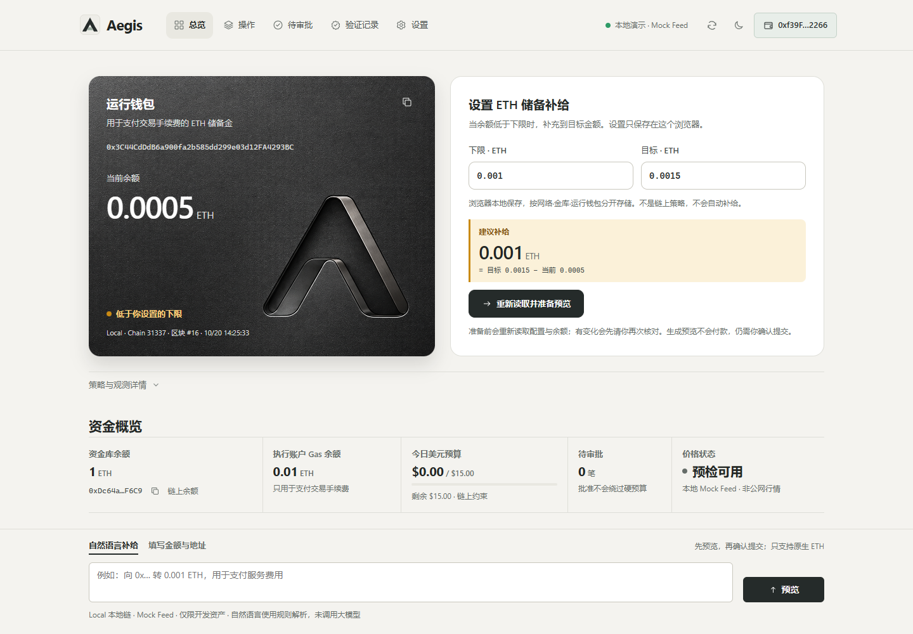
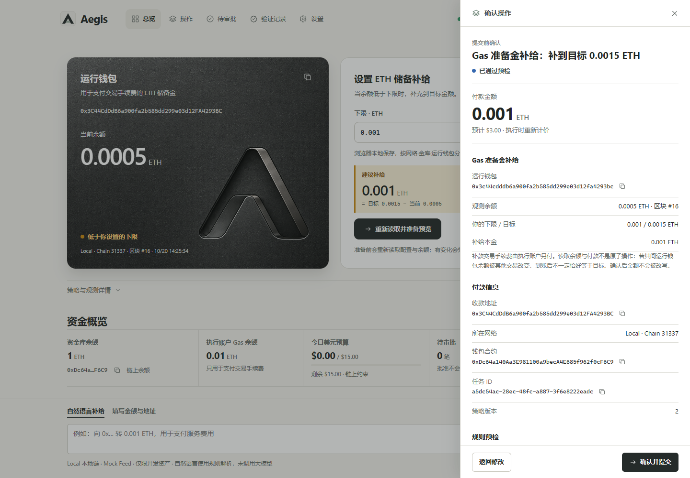
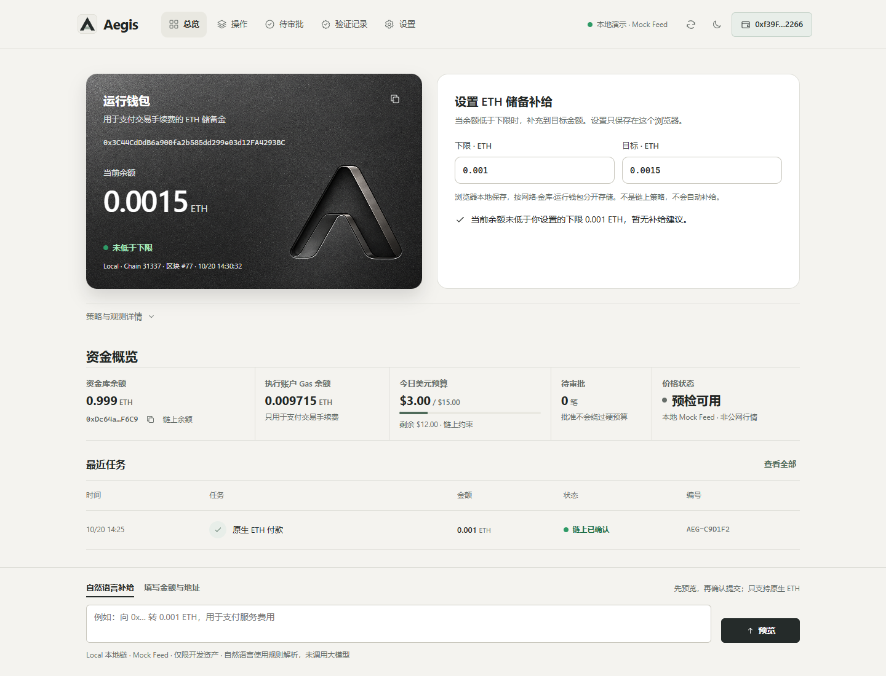
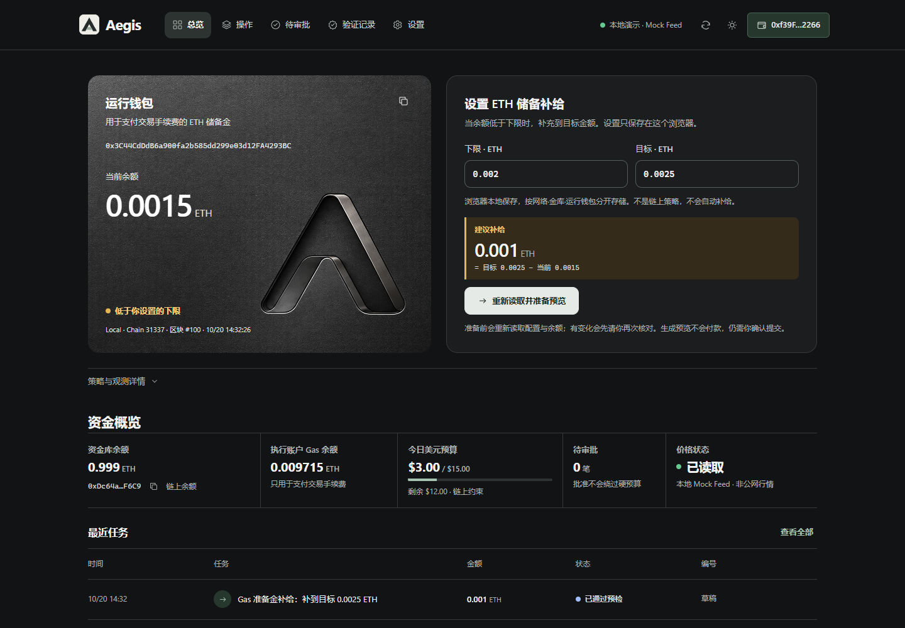
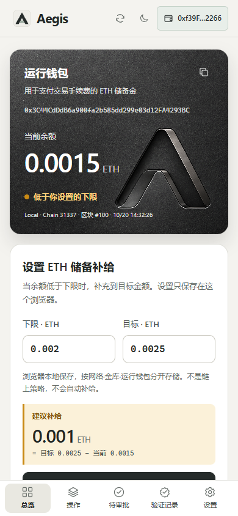
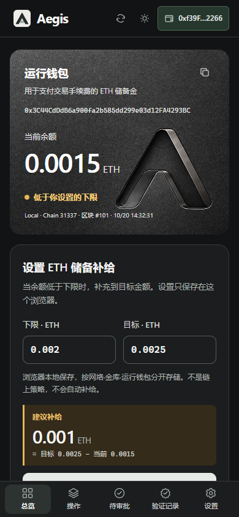

<p align="center">
  
</p>

<h1 align="center">Fuel your agent.<br>Keep control.</h1>

<p align="center">
  AegisAgent · Gas-reserve top-ups for agent operating wallets.<br>
  <strong>On-chain USD budgets. Explicit confirmation. Verifiable outcomes.</strong>
</p>

<p align="center">
  English · <a href="README.md">简体中文</a>
</p>

<p align="center">
  <a href="#where-chainlink-and-ai-fit"></a>
  
  <a href="LICENSE"></a>
</p>

<p align="center">
  <a href="#problem-and-solution">About</a> ·
  <a href="#product-screenshots">Demo</a> ·
  <a href="#user-flow">User flow</a> ·
  <a href="#where-chainlink-and-ai-fit">Chainlink</a> ·
  <a href="#quickstart">Run locally</a> ·
  <a href="#validation">Validation &amp; deployment</a> ·
  <a href="#team">Team</a>
</p>

Built during ETH Shenzhen 2026 Hackathon.

- **Verified:** A single-treasury, single-operating-wallet native ETH top-up flow on local chain 31337 with a Mock ETH/USD Feed.
- **Intent input:** A deterministic rule parser creates drafts and asks for missing or ambiguous details.
- **Pending:** In-application verification with a live Chainlink Feed, Sepolia deployment and payment, and a live LLM.

<a name="problem-and-solution"></a>

##  Problem and solution

**Problem.** An agent's operating wallet needs native ETH to pay transaction fees. When it runs dry the agent stops, and letting the agent refill itself would hand fund authority to automation.

**Solution.** Aegis reads the real ETH balance of one designated operating wallet, suggests a top-up from the user's own threshold and target, and has the treasury contract execute the transfer within on-chain USD limits, only after explicit user confirmation.

<a name="product-screenshots"></a>

##  Product screenshots

Captured from the running application on local chain **31337**, using a **Mock ETH/USD Feed**. The demonstration thresholds are set relative to the actual prefunded wallet balance; the displayed balance is not fabricated.

### 1. Check the operating reserve

The balance is below the explicitly configured demo threshold. The application suggests the exact target-minus-balance amount: **0.001 ETH**.



### 2. Review before paying

Review the recipient, **0.001 ETH** amount and **$3.00** mock-feed valuation. Preparing a preview does not pay; the user must confirm explicitly.



### 3. Recover the completed task

After the confirmed local-chain transfer and a page refresh, the reserve is healthy and the original executed task is recovered. The accompanying browser test verifies that no second payment is created.



### 4. Light, dark, and mobile

The top-right appearance button switches between light and dark. The choice is saved in the current browser. Switching appearance does not submit a payment or clear reserve settings. This is the actual dark workspace; its pictured draft has not been paid.



Actual light and dark interfaces at 390px. The operating wallet, reserve editor, and preparation action stack vertically, with reachable bottom navigation.

<p align="center">
  
  
</p>

<a name="user-flow"></a>

##  User flow

1. Sign in as Owner with the local test wallet (or a browser wallet); login does not authorize a payment.
2. On Overview, read operating-wallet balance B. Set the threshold to B + 0.0005 ETH and the target to B + 0.001 ETH.
3. Prepare the 0.001 ETH suggestion, inspect the confirmation drawer, confirm, then check the task, receipt and event evidence.
4. At the initial mock price a 0.002 ETH payment needs a separate Owner approval; 0.004 ETH exceeds the hard cap and is blocked. Owner approval cannot override hard limits.
5. Refresh to recover the same task. An unknown broadcast stays under reconciliation; it is not reported as a successful payment or replaced with a new one.

Budget accumulates across executed payments; pending requests reserve neither funds nor budget. Start a fresh local chain and database to repeat the full scenario.

<a name="features"></a>

##  Features

- Read the operating wallet's actual ETH balance, bound to the returned wallet address and observation block.
- Set a browser-local reserve threshold and target; calculate the exact target-minus-balance top-up. The settings are not on-chain policy and not an automatic scheduler.
- Re-read configuration, balance and pending tasks before preparing; a changed amount must be reviewed again.
- Preview the recipient, ETH amount, USD estimate, user-confirmed USD cap on the transferred principal and approval requirement.
- After explicit confirmation, follow the original task through execution, Owner approval, cancellation or reconciliation.

- Light/dark appearance with a browser-local preference; the same workflow on desktop and mobile.

The treasury balance, the executor's transaction-gas balance and the recipient's operating reserve are separate.

<a name="where-chainlink-and-ai-fit"></a>

##  Where Chainlink and AI fit

**Chainlink ETH/USD Data Feed** prices the transferred principal and takes part in the contract's final authorization decision, including approval-time revalidation:

- [AegisPriceOracle.sol](contracts/contracts/AegisPriceOracle.sol) validates feed rounds, answers, timestamps and decimals, and rounds USD6 valuations upward.
- [AegisWallet.sol](contracts/contracts/AegisWallet.sol) enforces quote freshness, user-confirmed USD maximums, per-payment and shared daily limits, recipient permissions, nonce, deadline and policy version.
- [chain.ts](backend/src/chain.ts) reads snapshots and quotes, simulates execution, and validates transaction and event binding.
- [MockV3Aggregator.sol](contracts/contracts/mocks/MockV3Aggregator.sol) supplies the local demo and fault-test data.

ETH/USD values the transferred principal; it is not a gas-price oracle. The sender pays transaction gas separately.

**AI.** No live model participates today: natural-language input only produces a draft through the rule parser, and missing or ambiguous content (for example a USD amount) asks the user to clarify. Every draft needs a preview and user confirmation; parsing cannot bypass confirmation, on-chain limits, fresh prices or replay protection.

**Status.** The application is verified on a local chain with a Mock Feed. In-application live Feed verification, Sepolia deployment and payment, and a live LLM remain pending.

<a name="architecture-and-stack"></a>

##  Architecture and stack

```text
Browser UI ─ local API + SQLite ─ treasury contract ─ ETH/USD feed
 (Vite/TS)   (Node 24, viem, Zod)   (Solidity)         (Mock locally)
```

- One treasury, one allowed operating wallet, one Owner and one restricted executor; Owner login and approvals use wallet signatures.
- Local chain 31337 is used for repeatable tests. Ethereum Sepolia is the only intended public network and is not deployed or verified.
- See [architecture](docs/ARCHITECTURE.md), [API and local integration](docs/INTEGRATION.md) and [security boundaries](docs/SECURITY.md).

<a name="quickstart"></a>

##  Quickstart

Requires Node.js 24+ and npm. Run commands from the repository root.

```bash
npm ci --ignore-scripts
```

Terminal 1:

```bash
npm run chain
```

Terminal 2, after the RPC starts:

```bash
npm run deploy:local
```

Terminal 3:

```bash
npm run dev
```

Open [http://127.0.0.1:5173](http://127.0.0.1:5173). The API listens on port 3001 and the local RPC on 8545; chain ID is 31337. Select the explicit local test-wallet entry to sign in with the public development Owner. These development accounts and ETH have no real-world value and must not be used for public funds.

The deployment funds the treasury with 1 ETH and configures a $5 threshold for execution without separate Owner approval, a $10 hard per-payment cap and a $15 shared UTC daily budget. The local Mock Feed initially returns $3,000 per ETH.

Layout: `frontend/` (Vite + TypeScript UI), `backend/` (Node.js, viem, Zod, SQLite), `contracts/` (Solidity, Hardhat, deployment, contract tests), `packages/shared/` (API types and ABI), `agent/` (early Python prototype, outside the current runtime).

<a name="validation"></a>

##  Validation

```bash
npm run check
npm run test:e2e
```

Verified locally on October 20, 2026 with Node 24.19.0: type checks and production builds; **27 contract tests**, **28 backend test counts** including nested tests; **9 browser cases** across independent wallet (2) and reserve (7) stacks. Another 36 browser checks cover light/dark appearance, 1440/390/320px layouts, reachable previews and switching appearance without submitting payments.

Contract tests cover authorization, oracle boundaries, budgets, approvals, replay and direct-call rejection. Backend tests cover HTTP boundaries, persistent recovery, event binding and operating-wallet address binding with explicit chain fixtures. Browser tests use real local contracts and balances with a Mock Feed, including confirmation, approval/cancellation, changed suggestions, missing data, missing or mismatched operating-wallet identity, offline failure and refresh without duplicate payment.

The browser entry starts a fresh chain and database for each group. Stop manually running services on ports 5173, 3001 and 8545 first. Windows can use installed Chrome; other environments may need `npx playwright install chromium`.

### Deployment and execution evidence

The published execution evidence currently comes from the local chain; there is no published Aegis Sepolia deployment or payment record yet. Running `npm run deploy:local` writes the actual addresses to the local `contracts/deployments/localhost.json` file. Each executed task exposes its transaction receipt, matching contract event, recipient, amount and request hash in the verification view.

Public-network contract addresses and transaction links will be published after a real deployment. A read-only Feed connectivity check does not establish that Aegis was deployed or made a payment.

<a name="team"></a>

##  Team

<table align="center">
  <tr>
    <td align="center" width="220"><a href="https://github.com/mia03ther"><br><b>MIA_Ether</b></a><br>Product · Frontend · Integration</td>
    <td align="center" width="220"><a href="https://github.com/gitgdut"><br><b>purple sun</b></a><br>Backend · Contracts</td>
  </tr>
  <tr>
    <td align="center" width="220"><a href="https://github.com/qiwei999"><br><b>qiwei999</b></a><br>AI intent parsing · Boundary validation</td>
    <td align="center" width="220"><a href="https://github.com/mantianxingdou10086"><br><b>mantianxingdou10086</b></a><br>Agent engineering · Intent evaluation</td>
  </tr>
</table>

### Documentation

| Document | Contents |
|---|---|
| [Architecture](docs/ARCHITECTURE.md) | Components, identities and balances, reserve and payment lifecycle |
| [API and local integration](docs/INTEGRATION.md) | Endpoints, local operation and verification record |
| [Security boundaries](docs/SECURITY.md) | Authorization, integrity and known limits |
| [Contract rules](contracts/README.md) | On-chain authorization rules and local deployment |
| [Interface design system](frontend/DESIGN.md) | Layout, themes, components and accessibility |

[Contributors](https://github.com/0xChainAegis/aegis-agent/graphs/contributors)

<p align="center">
  
</p>

MIT — see [LICENSE](LICENSE).
