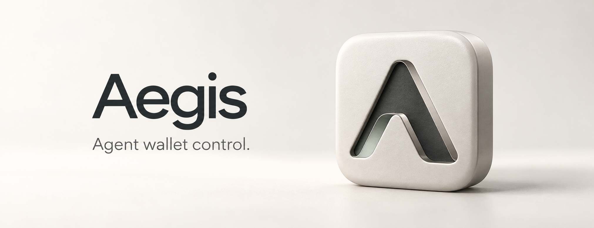

<p align="center"></p>

<p align="center"><strong>Refill an agent wallet's gas reserve within on-chain spending rules.</strong><br>Real balances · Explicit confirmation · Chainlink USD limits · Verifiable execution</p>

<p align="center"><a href="README.md">简体中文</a> · English</p>

<p align="center">
  <a href="https://github.com/0xChainAegis/aegis-agent/actions/workflows/ci.yml"></a>
  <a href="https://sepolia.etherscan.io/tx/0x47340b28f1b5eaa11c4ce8e2ffadc2937dfb0f3d55ffb35add32c40fb2bfcec2"></a>
  <a href="docs/CHAINLINK.md"></a>
  
  <a href="LICENSE"></a>
</p>

##  Problem and product

An agent's operating wallet needs native ETH to pay transaction fees. An empty wallet interrupts work. Unrestricted access to the funding pool expands the money at risk.

Aegis serves operators of agents that perform on-chain tasks. It reads one operating wallet's real balance and suggests a refill from the user's reserve threshold and target. After explicit user confirmation, a restricted executor submits the request to a funding contract. The contract enforces recipient permissions, USD caps, expiry and policy version using a real Chainlink ETH/USD quote.

A form or an optional language model can produce a draft. The model cannot change the deployed budget, acquire Owner permissions or skip confirmation.

##  Verified Sepolia payment

**On 22 October 2026, a user-confirmed web refill of 0.0001 ETH executed on Ethereum Sepolia.**

- [Transaction, receipt and logs](https://sepolia.etherscan.io/tx/0x47340b28f1b5eaa11c4ce8e2ffadc2937dfb0f3d55ffb35add32c40fb2bfcec2): block **11969287**, receipt status 1.
- [Funding pool](https://sepolia.etherscan.io/address/0xD7FD1c334c24FcAb35cF6200F470ab8F238347E8): `0xD7FD1c334c24FcAb35cF6200F470ab8F238347E8`.
- Operating-wallet balance: **0 to 0.0001 ETH**. Pool balance: **0.005 to 0.0049 ETH**.
- Wallet `NativeTransferExecuted` and PolicyEngine `BudgetConsumed` match the request hash, executor and USD cost in the same transaction.
- Thirteen independent read-only RPC checks matched the receipt, events and exact balance changes. [Public verification record](docs/evidence/sepolia-payment-2026-10-22.json) · [Evidence scope](docs/EVIDENCE.md).

This acceptance used rule parsing. Live LLM and other testnet safety scenarios require separate acceptance; this record covers the payment above.

##  Why Chainlink is part of payment authorization

The ETH/USD Feed values transferred principal so an operator can enforce budgets in dollars while ETH prices change.

- **$5 automatic-approval threshold**. Every web payment still requires explicit user confirmation.
- **$10 hard per-transfer limit and $15 shared UTC daily limit**. Owner approval cannot bypass either cap.
- **Price checks**: positive answer, complete round, valid timestamp, fixed decimals and freshness. Approval execution rechecks the quote and rules.
- **Execution evidence**: the wallet event includes the quote round and update time. The policy event records actual budget consumption.

Sepolia Feed: [`0x694AA1769357215DE4FAC081bf1f309aDC325306`](https://sepolia.etherscan.io/address/0x694AA1769357215DE4FAC081bf1f309aDC325306). The verified 0.0001 ETH principal cost **$0.240072**, rounded upward in USD6.

ETH/USD is **not a network gas-price feed**. Transfer principal and the executor's transaction fee are separate. [Integration, formula and limits](docs/CHAINLINK.md).

##  User flow and roles

1. Choose an extension, connect, then sign the Owner login message. Login does not authorize payment.
2. Read operating-wallet balance B and set a threshold and target. The suggestion is target minus B. Settings remain in this browser and do not schedule payments.
3. Prepare a preview after re-reading configuration, balance and in-flight tasks. A changed amount requires another review.
4. Review the complete recipient, amount, maximum USD cost and approval path, then explicitly confirm.
5. Inspect the task, receipt and matched events. Larger permitted payments need a separate Owner approval transaction. Hard rules remain enforced.

The **Owner** administers policy and approvals, the **executor** submits permitted requests, the **pool contract** holds refill funds, and the **operating wallet** receives ETH. Connecting an arbitrary address never grants administration of someone else's pool.

##  Interface

The ceramic and graphite interface supports light and dark themes and mobile layouts.


This screenshot uses chain 31337 and a Mock Feed for reproducibility. The public Sepolia transaction above is separate evidence.

<details><summary>Confirmation, recovery and mobile views</summary>


<p align="center"></p>

</details>

##  Architecture and stack

`Vite / TypeScript UI → Node.js 24 API / SQLite → viem → Solidity pool and policy contracts → Chainlink ETH/USD Feed`

- UI: wallet discovery, reserve suggestion, form or natural-language input, previews, approvals and evidence.
- Backend: Zod runtime validation, Owner login, persistent tasks, idempotent submission and original-transaction reconciliation.
- Contracts: ACL, locked price adapter, shared policy engine, pool and attestations.
- AI input: rule parsing by default, optional Anthropic and OpenAI-compatible live adapters. The Python Agent is an early prototype outside the current execution path.

##  Quick start

Use **Node.js 24+** and npm in the repository root:

```bash
npm ci --ignore-scripts
```

Run these in separate terminals:

```bash
# Terminal 1
npm run chain
# Terminal 2, after the node starts
npm run deploy:local
# Terminal 3
npm run dev
```

Open [http://127.0.0.1:5173](http://127.0.0.1:5173). Local chain ID is 31337, API port 3001 and RPC port 8545. This mode uses a Mock Feed. Published development keys are for local use only.

For **Sepolia**, configure the actual deployment, Owner, executor and RPC. The [Chinese startup and web acceptance guide](docs/STARTUP.zh-CN.md) is the short operational path; [the Sepolia guide](docs/SEPOLIA-DEMO.md) retains detailed deployment and evidence boundaries. Generated deployment and secret environment files remain outside Git.

**Live models** require a server-side project key, reachable Base URL and exact model ID. [Live setup](docs/LLM-LIVE-LOCAL.md). Responses identify the actual parser and fallback reason. Neither `off` nor `stub` is a live model call.

##  Validation

```bash
npm run check
npm run test:e2e
```

CI checks strict TypeScript, builds, contracts, backend, frontend and browser flows. E2E starts a separate local chain and database. Stop manual services on 5173, 3001 and 8545 first, or run it on another computer or CI.

Tests cover quotes, budgets, permissions, event bindings, replay, approvals, cancellation, unavailable data and recovery. Local automation, read-only testnet checks and confirmed public-chain payments have distinct scopes. [Evidence notes](docs/EVIDENCE.md).

##  Current scope

One running backend serves **one Owner pool and one configured operating wallet**, with native ETH refills, finite subscriptions and a fixed-route CCIP transfer flow. Browser reserve settings suggest amounts. They do not form a scheduler. Optional models create drafts and cannot pay directly.

Prompt scanning is an auxiliary heuristic. Structured output also undergoes validation, while contract policy constrains funds. The current product includes finite ETH subscriptions and a fixed Ethereum Sepolia → Base Sepolia CCIP-BnM route. Every subscription occurrence still requires a fresh preview and human confirmation, and CCIP source execution is verified separately from destination delivery. Automatic multi-user pool creation, multi-wallet allocation and unattended scheduled debits remain outside this delivery. The project does not claim a production security audit.

The historical 40-case intent evaluation includes version and sample limitations in [its report](eval/REPORT.md). Its scores do not establish current-version model accuracy.

##  Built at ETH Shenzhen

Newly developed during **ETH Shenzhen 2026**, focusing on constrained agent-payment execution and verifiable outcomes.


##  Team

<table width="100%">
  <tr>
    <td width="25%" align="center" valign="top">
      <a href="https://github.com/mia03ther"><br><b>MIA_Ether</b></a><br>
      <sub>Product · Frontend<br>Integration</sub>
    </td>
    <td width="25%" align="center" valign="top">
      <a href="https://github.com/gitgdut"><br><b>purple sun</b></a><br>
      <sub>Backend<br>Smart contracts</sub>
    </td>
    <td width="25%" align="center" valign="top">
      <a href="https://github.com/qiwei999"><br><b>qiwei999</b></a><br>
      <sub>Intent parsing<br>Boundary validation</sub>
    </td>
    <td width="25%" align="center" valign="top">
      <a href="https://github.com/mantianxingdou10086"><br><b>满天星斗烟火繁</b></a><br>
      <sub>Agent engineering<br>Intent evaluation</sub>
    </td>
  </tr>
</table>

##  Documentation

[Architecture](docs/ARCHITECTURE.md) · [API](docs/INTEGRATION.md) · [Chainlink](docs/CHAINLINK.md) · [Testnet evidence](docs/EVIDENCE.md) · [Security](docs/SECURITY.md) · [Contracts](contracts/README.md) · [Design system](frontend/DESIGN.md) · [Sepolia](docs/SEPOLIA-DEMO.md) · [Live models](docs/LLM-LIVE-LOCAL.md)

[Contributors](https://github.com/0xChainAegis/aegis-agent/graphs/contributors) · MIT. See [LICENSE](LICENSE).

<picture>
  <source media="(prefers-color-scheme: dark)" srcset="docs/images/aegis-footer-dark.svg">
  
</picture>
