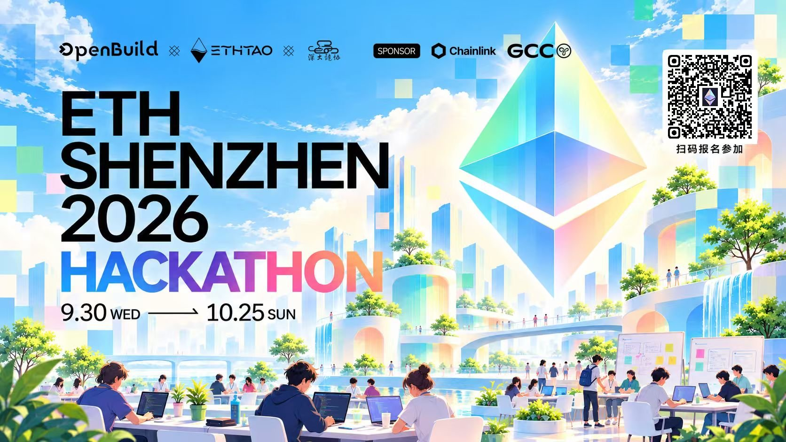

<p align="center">
  <picture>
    <source media="(prefers-color-scheme: dark)" srcset="docs/images/aegis-hero-dark.svg">
    
  </picture>
</p>

<p align="center">
  <strong>Gas-reserve top-ups for agent operating wallets, with every payment under control.</strong><br>
  On-chain USD limits · Explicit confirmation · Verifiable outcomes
</p>

<p align="center">
  English · <a href="README.md">简体中文</a>
</p>

<p align="center">
  <a href="#where-chainlink-and-ai-fit"></a>
  
  <a href="LICENSE"></a>
</p>

<p align="center">
  <a href="#problem-and-solution">About</a> ·
  <a href="#product-screenshots">Screenshots</a> ·
  <a href="#user-flow">Flow</a> ·
  <a href="#where-chainlink-and-ai-fit">Chainlink</a> ·
  <a href="#quickstart">Run</a> ·
  <a href="#validation">Validation</a> ·
  <a href="#team-and-documentation">Team</a>
</p>

<p align="center">
  Built at the ETH Shenzhen 2026 Hackathon.
</p>

<details>
  <summary>Event reference: ETH Shenzhen 2026 poster</summary>
  <p align="center">
    
  </p>
</details>

##  Problem and solution

**Problem.** An agent's operating wallet needs native ETH to pay transaction fees. When it runs dry the agent stops, and letting the agent refill itself would hand fund authority to automation.

**Solution.** One funding-pool smart contract pays native ETH to one configured receiving operating wallet to replenish its gas reserve. The user sets a threshold and target in the browser; Aegis suggests target minus actual balance, rechecks when preparing, and after explicit user confirmation the contract executes within its whitelist, permissions and USD limits.

**Four distinct roles.**

| Role | Field | Responsibility |
|---|---|---|
| Owner (funding administrator) | `ownerAddress` | Administers the pool and approves pending payments |
| Executor | `agentAddress` | Submits payment requests within authorized rules |
| Pool contract | `walletAddress` | Holds and pays the top-up funds |
| Receiving operating wallet | `recipientAddress` | Receives ETH and is shown on the overview; receiving grants no administrative rights |

Pool and operating-wallet balances are read separately. The LLM only drafts: it never signs and cannot bypass approvals.

##  Product screenshots

Captured from the running application on local chain **31337**, using a **Mock ETH/USD Feed**. The demonstration thresholds are set relative to the actual prefunded wallet balance; the displayed balance is not fabricated.

### 1. Check the operating reserve

The balance is below the explicitly configured demo threshold. The application suggests the exact target-minus-balance amount: **0.001 ETH**.


### 2. Review before paying

Review the recipient, **0.001 ETH** amount and **$3.00** mock-feed valuation. Preparing a preview does not pay; the user must confirm explicitly.


### 3. Recover the completed task

After the confirmed local-chain transfer and a page refresh, the reserve is healthy and the original executed task is recovered. The accompanying browser test verifies that no second payment is created.


### 4. Light, dark, and mobile

The top-right appearance button switches between light and dark. The choice is saved in the current browser. Switching appearance does not submit a payment or clear reserve settings. This is the actual dark workspace; the top-up suggestion has not been submitted.


Actual light and dark interfaces at 390px. The operating wallet, reserve editor, and preparation action stack vertically, with reachable bottom navigation.

<p align="center">
  
  
</p>

##  User flow

1. Sign in as Owner with the local test wallet (or a browser wallet); login does not authorize a payment.
2. On Overview, read operating-wallet balance B. Set the threshold to B + 0.0005 ETH and the target to B + 0.001 ETH.
3. Prepare the 0.001 ETH suggestion, inspect the confirmation drawer, confirm, then check the task, receipt and event evidence.
4. At the initial mock price a 0.002 ETH payment needs a separate Owner approval; 0.004 ETH exceeds the hard cap and is blocked. Owner approval cannot override hard limits.
5. Refresh to recover the same task. An unknown broadcast stays under reconciliation; it is not reported as a successful payment or replaced with a new one.

Budget accumulates across executed payments; pending requests reserve neither funds nor budget. Start a fresh local chain and database to repeat the full scenario.

##  Features

- Read the operating wallet's actual ETH balance, bound to the returned wallet address and observation block.
- Set a browser-local reserve threshold and target; calculate the exact target-minus-balance top-up. The settings are not on-chain policy and not an automatic scheduler.
- Re-read configuration, balance and pending tasks before preparing; a changed amount must be reviewed again.
- Preview the recipient, ETH amount, USD estimate, user-confirmed USD cap on the transferred principal and approval requirement.
- After explicit confirmation, follow the original task through execution, Owner approval, cancellation or reconciliation.
- Light/dark appearance with a browser-local preference; the same workflow on desktop and mobile.

The pool balance, the executor's transaction-gas balance and the recipient's operating reserve are separate.

##  Where Chainlink and AI fit

**Chainlink ETH/USD Data Feed** prices the transferred principal and takes part in the contract's final authorization decision, including approval-time revalidation:

- [AegisPriceOracle.sol](contracts/contracts/AegisPriceOracle.sol) validates feed rounds, answers, timestamps and decimals, and rounds USD6 valuations upward.
- [AegisPolicyEngine.sol](contracts/contracts/AegisPolicyEngine.sol) applies permissions, the recipient allowlist, approval thresholds and the shared daily USD budget.
- [AegisWallet.sol](contracts/contracts/AegisWallet.sol) enforces quote freshness, user-confirmed USD maximums, per-payment and shared daily limits, recipient permissions, nonce, deadline and policy version.
- [chain.ts](backend/src/chain.ts) reads snapshots and quotes, simulates execution, and validates transaction and event binding.
- [MockV3Aggregator.sol](contracts/contracts/mocks/MockV3Aggregator.sol) supplies the local demo and fault-test data.

ETH/USD values the transferred principal; it is not a gas-price oracle. The sender pays transaction gas separately.

**AI.** Rules are the default. `AEGIS_LLM_MODE=live` enables Anthropic or OpenAI-compatible draft parsing; `stub` is an offline test mode and does not demonstrate a real model. Model responses undergo schema and parameter checks: stale values cannot replace the user's new address or amount, and ambiguous fields require clarification. Every draft still needs preview and explicit confirmation, subject to on-chain limits, fresh prices and replay protection. See [integration configuration](docs/INTEGRATION.md).

##  Architecture and stack

```text
Browser UI ─ local API + SQLite ─ funding pool ─ ETH/USD feed
 (Vite/TS)   (Node 24, viem, Zod)  (Solidity)    (Mock locally)
```

- One funding pool, one allowed receiving operating wallet, one Owner and one restricted executor; Owner login and approvals use wallet signatures.
- Local chain 31337 is used for repeatable tests. Ethereum Sepolia is the public test network; see Validation below for acceptance status.
- See [architecture](docs/ARCHITECTURE.md), [API and local integration](docs/INTEGRATION.md) and [security boundaries](docs/SECURITY.md).

##  Quickstart

Requires Node.js 24+ and npm. Run commands from the repository root.

```bash
npm ci --ignore-scripts
```

> If npm 12 reports `EALLOWGIT`, the lockfile contains a commit-pinned Git dependency. Verify its source and follow [npm's allow-git configuration](https://docs.npmjs.com/cli/v12/using-npm/config/#allow-git). Switching SSH to HTTPS still leaves a Git dependency; retain the repository lockfile.

Terminal 1:

```bash
npm run chain
```

Terminal 2, after the RPC starts:

```bash
npm run deploy:local
```

Terminal 3:

```bash
npm run dev
```

Open [http://127.0.0.1:5173](http://127.0.0.1:5173). The API listens on port 3001 and the local RPC on 8545; chain ID is 31337. Select the explicit local test-wallet entry to sign in with the public development Owner. These development accounts and ETH have no real-world value and must not be used for public funds.

The deployment funds the pool with 1 ETH and configures a $5 threshold for execution without separate Owner approval, a $10 hard per-payment cap and a $15 shared UTC daily budget. The local Mock Feed initially returns $3,000 per ETH.

Layout: `frontend/` (Vite + TypeScript UI), `backend/` (Node.js, viem, Zod, SQLite), `contracts/` (Solidity, Hardhat, deployment, contract tests), `packages/shared/` (API types and ABI), `agent/skills/` (intent parsing prompt; other Python prototypes are outside the current runtime).

##  Validation

```bash
npm run check
npm run test:e2e
```

Verified on October 21, 2026 with Node 24: type checks and production builds, **34 contract tests**, **56 backend test counts** including nested tests, and **16 browser cases** (9 wallet/connection and 7 reserve cases). Another **7 offline model-launcher tests** pass. Browser cases cover real local payments, Owner approval and cancellation, bound Wallet/PolicyEngine event evidence, account changes during login, disconnection, and recovery after refresh.

Contract tests cover authorization, oracle boundaries, budgets, approvals, replay and direct-call rejection. Backend tests cover HTTP boundaries, persistent recovery, event binding and operating-wallet address binding with explicit chain fixtures. Browser tests use real local contracts and balances with a Mock Feed, including confirmation, approval/cancellation, changed suggestions, missing data, missing or mismatched operating-wallet identity, offline failure and refresh without duplicate payment.

The browser entry starts a fresh chain and database for each group. Stop manually running services on ports 5173, 3001 and 8545 first. Windows can use installed Chrome; other environments may need `npx playwright install chromium`.

### Deployment and execution evidence

The local payment flow is verified. Sepolia deployment and read-only binding checks exist; browser-payment acceptance with the latest policy-engine deployment remains pending. The [intent evaluation report](eval/REPORT.md) preserves historical model results and limitations; its scores do not describe the current version.

The demo covers one funding pool, one receiving operating wallet and native ETH. Scheduled automatic payments, multi-wallet management, subscriptions and CCIP execution are outside the delivered scope.

All published payment-execution evidence comes from the local chain; there is no accepted record of a Sepolia browser payment yet. Running `npm run deploy:local` writes the actual addresses to the local `contracts/deployments/localhost.json` file. Each executed task binds the Wallet payment event to the PolicyEngine budget event and exposes the risk decision, Chainlink round, recipient, amount and request hash.

Public-network contract addresses and transaction links will be published after an independently verified deployment and an accepted browser payment. A read-only Feed connectivity check does not establish that Aegis was deployed or made a payment.

##  Team and documentation

<a href="https://github.com/mia03ther"> <b>MIA_Ether</b></a> — Product · Frontend · Integration<br>
<a href="https://github.com/gitgdut"> <b>purple sun</b></a> — Backend · Contracts<br>
<a href="https://github.com/qiwei999"> <b>qiwei999</b></a> — AI intent parsing · Boundary validation<br>
<a href="https://github.com/mantianxingdou10086"> <b>mantianxingdou10086</b></a> — Agent engineering · Intent evaluation

| Document | Contents |
|---|---|
| [Architecture](docs/ARCHITECTURE.md) | Components, identities and balances, reserve and payment lifecycle |
| [API and local integration](docs/INTEGRATION.md) | Endpoints, local operation and verification record |
| [Security boundaries](docs/SECURITY.md) | Authorization, integrity and known limits |
| [Contract rules](contracts/README.md) | On-chain authorization rules and local deployment |
| [Interface design system](frontend/DESIGN.md) | Layout, themes, components and accessibility |
| [Live LLM integration](docs/LLM-LIVE-LOCAL.md) | Environment variables, launchers and local limits for live mode |
| [Intent evaluation report](eval/REPORT.md) | 40 cases, results for three parsers and failure attribution |

[Contributors](https://github.com/0xChainAegis/aegis-agent/graphs/contributors) · MIT — see [LICENSE](LICENSE).

<p align="center">
  <picture>
    <source media="(prefers-color-scheme: dark)" srcset="docs/images/aegis-footer-dark.svg">
    
  </picture>
</p>
