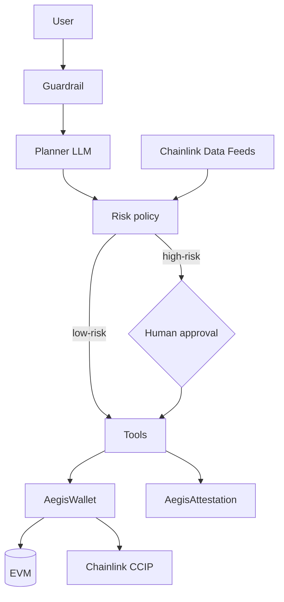

# AegisAgent — 0xChainAegis

> A security-first AI financial agent: natural-language money operations with
> permission tiers, human approval, prompt-injection defense and an
> append-only on-chain audit trail.

AegisAgent is built for two competitions on one codebase:

- **ETH Shenzhen 2026 Hackathon** — on-chain payments, verification and cross-chain
- **FinTechathon 2026 (Shenzhen International FinTech Competition)** — AI Banking Agent

## What it does

| Capability | Banking mode | On-chain mode |
|---|---|---|
| Transfer / pay | internal transfer to a trusted payee | ETH / ERC20 transfer, CCIP cross-chain |
| Analyze | bills and spending breakdown | decoded transaction analytics |
| Subscriptions | list recurring payments | list / settle / cancel on-chain subscriptions |
| Risk control | payee block list, balance checks | permission tiers, per-tx ceilings, human approval |
| Audit | application logs | on-chain attestation registry |

## Why it is safe

1. **Guardrail before the LLM** — injection and extraction attempts are blocked
   before the model ever sees them
2. **The model never authorizes** — a deterministic policy engine and smart
   contracts decide what executes
3. **Human in the loop** — high-risk actions pause in the agent graph and queue
   in the contract; two independent approvals are required
4. **Every action is attested** — a canonical intent hash is recorded on-chain
   before any value moves, and records are immutable
5. **Bounded blast radius** — even a stolen agent key is capped by tier,
   per-transaction ceilings and allowlists

## Architecture



Full diagram and lifecycle: [docs/ARCHITECTURE.md](docs/ARCHITECTURE.md).
Security design and known risks: [docs/SECURITY.md](docs/SECURITY.md).

## Quickstart

### 1. Contracts

```bash
cd contracts
npm install
cp .env.example .env   # set PRIVATE_KEY and AGENT_ADDRESS
npm run compile
npm test
npm run deploy         # local network
```

### 2. Agent

```bash
cd agent
python -m venv .venv
# Windows: .venv\Scripts\activate
pip install -r requirements.txt
cp .env.example .env   # MOCK_MODE=true runs fully offline
python -m aegis_agent.main
```

### 3. Frontend demo

Open `frontend/index.html` in a browser — no build step.

## Repository layout

```
aegis-agent/
├── contracts/          # Solidity: access control, wallet, attestation, CCIP, oracle
├── agent/              # Python LangGraph agent, guardrails, tools
├── frontend/           # zero-build demo console
├── docs/               # architecture and security design
└── README.md
```

## Chainlink integrations (Bounty mapping)

- **CCIP** — [AegisCCIPSender.sol](contracts/contracts/AegisCCIPSender.sol):
  `transferTokenCrossChain`, allowlisted destinations, native fee quoting
- **Data Feeds** — [AegisPriceOracle.sol](contracts/contracts/AegisPriceOracle.sol):
  `getUsdValue` powers stable risk limits
- Files and usage are labeled inside each contract as required by the Bounty rules.

## Tech stack

- Solidity 0.8.24 · OpenZeppelin 5 · Chainlink CCIP & Data Feeds · Hardhat
- Python · LangGraph · LangChain · web3.py
- HTML + viem demo frontend

## Roadmap

- [ ] Wire wallet approvals and subscriptions end-to-end on testnet
- [ ] Upload full action payloads to IPFS for complete attestation
- [ ] Move agent signing to a hardware signer / multisig
- [ ] Add zkML inference proof (EZKL) for verifiable policy decisions
- [ ] Hosted service with auth and rate limits

## License

MIT — see [LICENSE](LICENSE).
