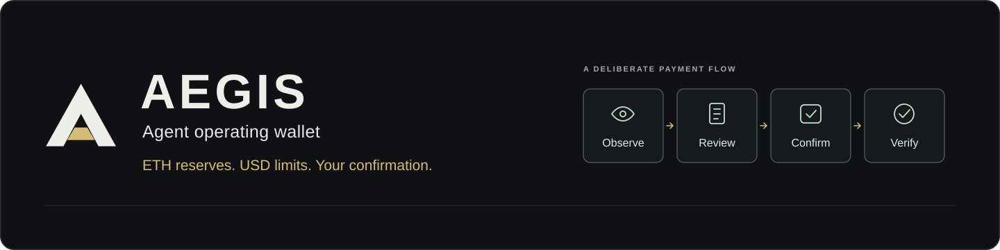

<p align="center">
  
</p>

<h1 align="center">AegisAgent</h1>

<p align="center">
  为智能体运行钱包补充 Gas 储备。<br>
  <strong>链上美元预算 · 用户明确确认 · 可核对的执行结果</strong>
</p>

<p align="center">
  <a href="README.en.md">English</a> · 简体中文
</p>

<p align="center">
  <a href="https://nodejs.org/"></a>
  <a href="https://www.typescriptlang.org/"></a>
  <a href="https://soliditylang.org/"></a>
  <a href="#chainlink-集成"></a>
  
  <a href="LICENSE"></a>
</p>

<p align="center">
  <a href="#产品">产品</a> ·
  <a href="#产品截图">截图</a> ·
  <a href="#本地运行">快速开始</a> ·
  <a href="#chainlink-集成">Chainlink</a> ·
  <a href="#验证">验证</a> ·
  <a href="#团队">团队</a>
</p>

本项目诞生于 ETH Shenzhen 2026 黑客松。当前版本运行在本地以太坊开发链上，使用 Mock ETH/USD Feed。自然语言输入由规则解析器处理；在线 LLM 接入与公共测试网部署尚未验证。

## 产品

- 读取已配置运行钱包的真实 ETH 余额及其观测区块。
- 在浏览器本地设置储备下限与目标值，按“目标值减当前余额”精确计算补充金额。
- 准备付款前重新读取配置、余额与待处理任务；金额发生变化时，要求再次检查。
- 预览收款地址、ETH 金额、美元估值、可接受的最高费用及审批要求。
- 用户明确确认后，持续跟踪原任务的执行、Owner 审批、取消或交易核对状态。

资金库余额、执行账户支付交易 Gas 的余额与收款钱包的运行储备相互独立。储备设置仅用于生成建议，并非链上策略，也不构成自动调度器。

## 产品截图

以下截图来自本地开发链（chain ID 31337），使用 Mock ETH/USD Feed。

### 1. 发现运行储备不足

读取钱包真实余额 B，以 B + 0.0005 ETH 为演示下限、B + 0.001 ETH 为目标值，得到 0.001 ETH 的补充建议。演示阈值基于实际余额设置，未伪造余额。


### 2. 检查并明确确认

预览收款地址与 0.001 ETH 补充金额；按本地 Mock ETH/USD Feed 的演示价格估值为 3.00 美元。预览不会转账，仍须用户明确确认。


### 3. 刷新后恢复原任务

确认后的本地链转账使真实余额增加 0.001 ETH，储备恢复充足。刷新后仍显示同一个已执行任务，不会创建重复付款。


## 本地运行

需要 Node.js 24+ 与 npm。请在仓库根目录执行以下命令。

```bash
npm ci --ignore-scripts
```

终端 1：

```bash
npm run chain
```

终端 2，在 RPC 启动后执行：

```bash
npm run deploy:local
```

终端 3：

```bash
npm run dev
```

打开 [http://127.0.0.1:5173](http://127.0.0.1:5173)。API 监听 3001 端口，本地 RPC 监听 8545 端口，chain ID 为 31337。选择明确标注的本地测试钱包入口，使用公开的开发用 Owner 账户登录。这些开发账户与 ETH 没有现实价值，不得用于存放真实资金。

部署脚本向资金库注入 1 ETH，并设置无需单独 Owner 审批的 5 美元阈值、10 美元单笔硬上限及 15 美元共享 UTC 每日预算。每笔付款仍须用户明确确认。本地 Mock Feed 的初始价格为每 ETH 3,000 美元。

## 演示流程

1. 在 Overview 读取运行钱包余额 B。将下限设为 B + 0.0005 ETH，目标值设为 B + 0.001 ETH。这些测试设置考虑了本地账户已预先获得资金的情况，未伪造余额。
2. 准备 0.001 ETH 的补充建议。检查确认抽屉后明确确认，再查看生成的任务及交易回执、事件证据。
3. 按初始模拟价格，0.002 ETH 的付款需要单独的 Owner 审批。0.004 ETH 的付款超过硬上限，将被阻止。Owner 审批不能绕过硬性限制。
4. 刷新页面以恢复同一个任务。广播结果未知的交易会继续核对，不会被报告为付款成功，也不会被新付款替代。

预算按已执行付款累计消耗。待处理请求不会预占资金或预算。重复完整测试场景时，请使用全新的本地链与数据库。

## Chainlink 集成

ETH/USD 数据参与合约的最终授权判断，包括审批时的重新校验：

- [AegisPriceOracle.sol](contracts/contracts/AegisPriceOracle.sol) 校验 Feed 轮次、价格、时间戳及精度，并将 USD6 估值向上取整。
- [AegisWallet.sol](contracts/contracts/AegisWallet.sol) 强制校验报价时效、用户确认的美元上限、单笔与共享每日限额、收款地址权限、nonce、截止时间及策略版本。
- [chain.ts](backend/src/chain.ts) 读取快照与报价、模拟执行，并校验交易和事件的绑定关系。
- [MockV3Aggregator.sol](contracts/contracts/mocks/MockV3Aggregator.sol) 提供本地演示与故障测试所需的数据。

ETH/USD 用于计算转账本金的美元价值，并非 Gas 价格预言机。发送方另行支付交易 Gas。本仓库尚未验证 Sepolia 付款或真实 Chainlink Feed 接入。

## 验证

```bash
npm run check
npm run test:e2e
```

2026 年 10 月 18 日使用 Node 24.19.0 在本地完成验证：类型检查与生产构建；**27 项合约测试**、**26 项后端测试（含嵌套测试）**；独立钱包与储备测试环境中的 **6 个浏览器用例**。

合约测试覆盖授权、预言机边界、预算、审批、重放及直接调用拒绝。后端测试通过明确的链测试夹具覆盖 HTTP 边界、持久化恢复与事件绑定。浏览器测试使用真实本地合约与余额以及 Mock Feed，覆盖确认、审批与取消、建议金额变化、数据缺失、离线失败，以及刷新后不重复付款。

浏览器测试入口为每组测试启动全新的链与数据库。运行前，请先停止手动运行且占用 5173、3001、8545 端口的服务。Windows 可使用已安装的 Chrome；其他环境可能需要执行 `npx playwright install chromium`。

## 实现

- `frontend/`：Vite 与 TypeScript DOM 界面。
- `backend/`：Node.js、viem、Zod 与 SQLite。
- `contracts/`：Solidity、Hardhat、部署脚本与合约测试。
- `packages/shared/`：API 类型与 ABI 签名。
- `agent/`：早期 Python 原型，不在当前运行链路中。

## 团队

- [MIA_Ether](https://github.com/mia03ther) — **产品、前端与集成**
- [purple sun](https://github.com/gitgdut) — **后端与 API**
- [qiwei999](https://github.com/qiwei999) — **合约与边界测试**

[架构](docs/ARCHITECTURE.md) · [API 与本地集成](docs/INTEGRATION.md) · [安全边界](docs/SECURITY.md)

[贡献者](https://github.com/0xChainAegis/aegis-agent/graphs/contributors)

MIT 许可证 — 参见 [LICENSE](LICENSE)。
