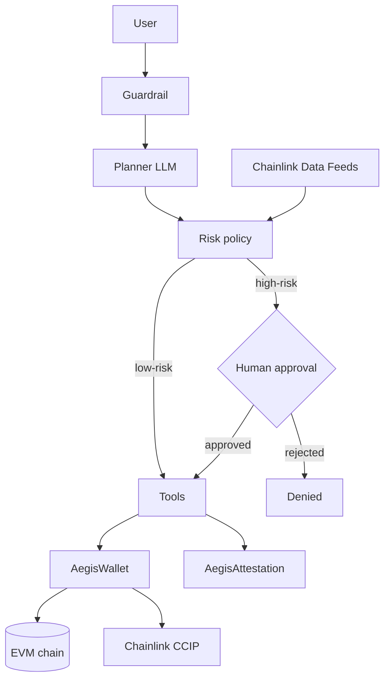

# AegisAgent

> A security-first AI agent for on-chain finance — natural-language crypto
> payments and subscriptions, bounded by prompt-injection defense, permission
> tiers, human approval and an on-chain audit trail.

Project for **ETH Shenzhen 2026 Hackathon** (Oct 24–25, Shenzhen).
Team: **0xChainAegis**

## What it does

AegisAgent can actually move value on-chain, but only inside hard security boundaries:

- **Natural-language payments** — send ETH / ERC-20 by asking in plain language
- **On-chain subscriptions** — create, settle and cancel recurring payment agreements
- **Financial analytics** — decoded transactions, spending breakdown, top counterparties
- **Permission tiers** — read-only / low-risk auto / high-risk approval
- **Human approval** — above-limit transfers queue on-chain and execute only after the owner approves
- **Prompt-injection defense** — untrusted text is screened before the LLM sees it
- **On-chain attestation** — every action is recorded in an append-only registry before value moves
- **Cross-chain** — token transfers across chains via Chainlink CCIP

## Why it is safe

1. **Guardrail before the LLM** — injection / extraction attempts are blocked before the model ever sees them
2. **The model never authorizes** — a deterministic policy engine and smart contracts decide what executes
3. **Human in the loop** — high-risk actions pause in the agent graph and queue in the contract
4. **Every action is attested** — a canonical intent hash is recorded on-chain before value moves; records are immutable
5. **Bounded blast radius** — even a compromised agent key is capped by tier, per-transaction ceilings and allowlists

## Track mapping

The hackathon has no fixed tracks. AegisAgent spans three of the suggested directions:

| Suggested direction | AegisAgent component |
|---|---|
| Agent & machine economy | autonomous on-chain payments, subscriptions, auto-settlement |
| Privacy & security | prompt-injection defense, permission tiers, human approval |
| Verifiable AI | on-chain attestation of every agent action |

## Chainlink Bounty mapping

The project uses Chainlink as a critical orchestration/data layer, not just a demo hookup:

- **CCIP** — [`AegisCCIPSender.sol`](contracts/contracts/AegisCCIPSender.sol): `transferTokenCrossChain`, allowlisted destinations, native fee quoting
- **Data Feeds** — [`AegisPriceOracle.sol`](contracts/contracts/AegisPriceOracle.sol): `getUsdValue`, so risk limits are expressed in stable USD value

## Architecture



Full diagram and request lifecycle: [docs/ARCHITECTURE.md](docs/ARCHITECTURE.md)
Security design and known risk list: [docs/SECURITY.md](docs/SECURITY.md)

## Quickstart

### 1. Contracts

```bash
cd contracts
npm install
cp .env.example .env   # set PRIVATE_KEY and AGENT_ADDRESS
npm run compile
npm test
npm run deploy         # local Hardhat network
```

### 2. Agent

```bash
cd agent
python -m venv .venv
.venv\Scripts\activate   # Windows
pip install -r requirements.txt
cp .env.example .env     # MOCK_MODE=true runs fully offline
python -m aegis_agent.main
```

### 3. Frontend demo

Open `frontend/index.html` in a browser — no build step.

## Repository layout

```
aegis-agent/
├── contracts/          # Solidity: access control, wallet, attestation, CCIP, oracle
├── agent/              # Python LangGraph agent, guardrails, tools
├── frontend/           # zero-build demo console
├── docs/               # architecture and security design
└── README.md
```

## Tech stack

- Solidity 0.8.24 · OpenZeppelin 5 · Chainlink CCIP & Data Feeds · Hardhat
- Python · LangGraph · LangChain · web3.py
- HTML + viem demo frontend

## Roadmap

- [ ] Wire wallet approvals and subscriptions end-to-end on testnet
- [ ] Upload full action payloads to IPFS for complete attestation
- [ ] Move agent signing to a hardware signer / multisig
- [ ] Add zkML inference proof (EZKL) for verifiable policy decisions
- [ ] ERC-8004 / x402 agent reputation and payment pieces

## License

MIT — see [LICENSE](LICENSE).

---

# 中文说明

**AegisAgent** 是一个面向链上金融的安全 AI 智能体

参加 **ETH Shenzhen 2026 黑客松**，团队 **0xChainAegis**

**核心功能**

- 自然语言发起 ETH / ERC-20 转账
- 链上订阅的创建、扣款、取消
- 交易解析与账单分析
- 权限分级（只读 / 低风险自动 / 高风险审批）
- 超额转账链上排队、所有者审批后执行
- 提示词注入防护，未受信任文本先过护栏
- 每个动作在资金移动前写入链上存证
- 基于 Chainlink CCIP 的跨链转账

**安全原则**

1. 护栏在 LLM 之前
2. 模型不做授权，策略引擎和合约说了算
3. 高风险动作人工审批
4. 所有动作先存证、后执行，记录不可篡改
5. 即使私钥泄露，链上权限和限额也能锁死爆炸半径

**Chainlink 集成**

- CCIP：`AegisCCIPSender.sol` 跨链转账
- Data Feeds：`AegisPriceOracle.sol` 以 USD 计价风险限额

**快速开始**

```bash
cd contracts && npm install && npm test && npm run deploy
cd ../agent && pip install -r requirements.txt && python -m aegis_agent.main
```

前端演示直接打开 `frontend/index.html`
