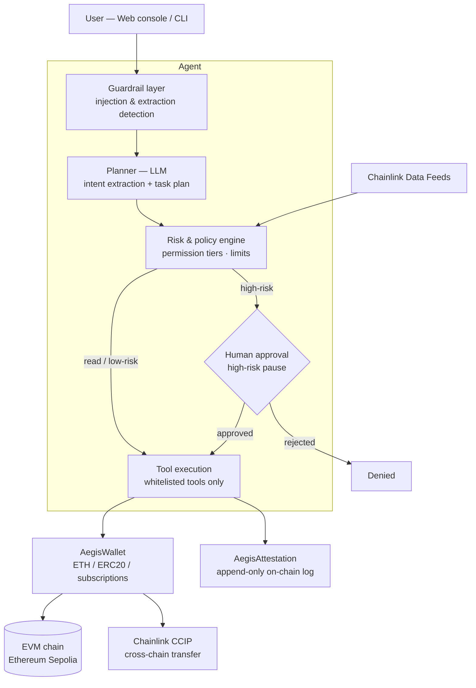
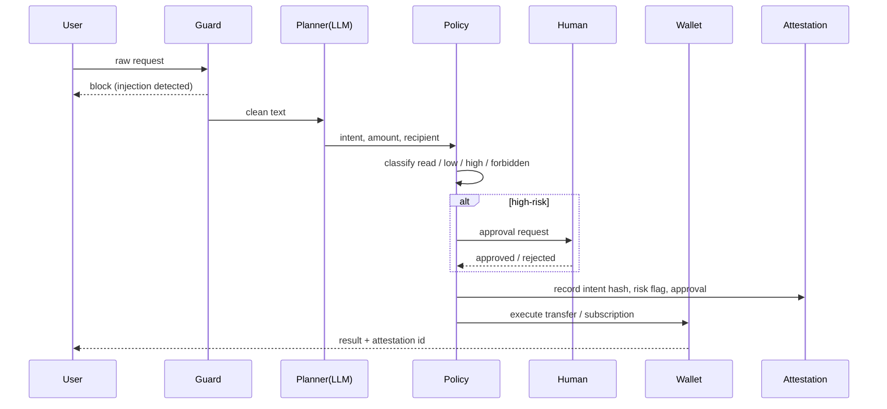

# AegisAgent Architecture

AegisAgent is a security-first AI financial agent operating on EVM blockchains.
The agent graph, guardrails and policy enforce that every value-moving action
is authorized, attested and bounded.

## 1. Layered view

## 2. Request lifecycle

## 3. Components

| Component | Responsibility | Tech |
|---|---|---|
| Guardrail | Block prompt injection / extraction before the LLM | regex signatures + scoring, no LLM dependency |
| Planner | Extract structured intent; never authorizes | LLM with structured output, offline rule-based fallback |
| Policy engine | Risk level, approval decision | deterministic Python, USD-valued via Data Feeds |
| Human approval | Pause high-risk actions | LangGraph `interrupt` + on-chain pending queue |
| AegisWallet | Custody, bounded transfers, subscriptions | Solidity, OZ |
| AegisAccessControl | Roles and tiers, per-agent ceilings | Solidity, OZ AccessControl |
| AegisAttestation | Append-only action audit log; stores canonical hash of the full record (request, intent, decision, model, approval, result) | Solidity |
| AegisCCIPSender | Cross-chain transfers | Chainlink CCIP |
| AegisPriceOracle | USD valuation | Chainlink Data Feeds |
| Frontend | Demo console | single HTML file, viem |

## 4. Security invariants

1. Attestation is written before value moves, and the record is immutable
2. Authorization is computed by the policy engine and contracts, never by the LLM
3. High-risk operations have two independent gates: graph-level approval and
   on-chain owner approval
4. Tools are a strict whitelist; unknown intents fail closed
5. The agent key is isolated; contracts bound what the key can do even if it
   is compromised (tier, per-tx ceiling, allowlist)

## 5. Demo evidence map

| Claim | Evidence |
|---|---|
| Agent can move value on-chain | AegisWallet executed transfer + transaction hash |
| Agent cannot exceed its authority | above-limit transfer queues; only `approveAndExecute` releases it |
| Every action is verifiable | AegisAttestation record with canonical intent hash |
| Stable risk limits | USD valuation via Chainlink Data Feeds |
| Cross-chain reach | Chainlink CCIP sender + message id |
